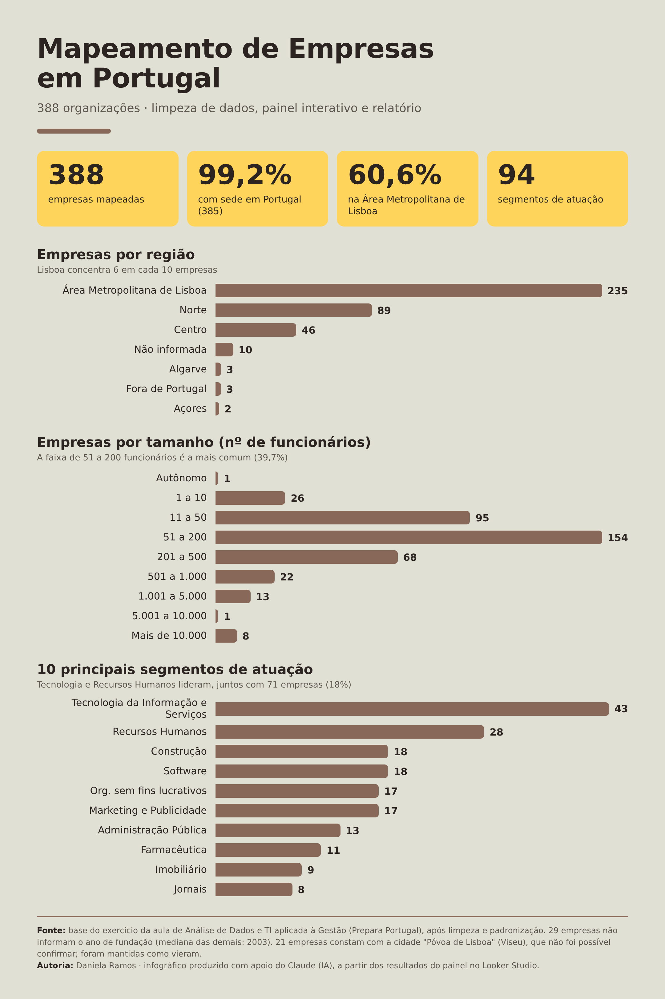

# Mapeamento de Empresas em Portugal — Limpeza de Dados e Painel Interativo

**Daniela Ramos** · Direito • Gestão • Dados • Análise

Projeto prático de análise de dados: limpar e padronizar uma base de 388 empresas sediadas (quase todas) em Portugal, construir um painel interativo e escrever um relatório descritivo do mercado mapeado.

---

## 📌 Origem do projeto

Exercício prático da aula de **Análise de Dados e TI aplicada à Gestão** (Prepara Portugal): *"Mapeamento de Empresas e Profissionais para Desenvolvimento Corporativo"*.

A base de dados é material do curso e **não está publicada neste repositório**. Aqui estão o processo, o código, o relatório e as imagens do painel.

## 🎯 O que foi pedido

1. Limpar e padronizar a base de empresas.
2. Criar um painel (Looker Studio) filtrável por **região, segmento e tamanho**.
3. Escrever um relatório descrevendo as empresas mapeadas.

## 🔗 Painel interativo

👉 **[Abrir o painel no Looker Studio](https://datastudio.google.com/reporting/a74113d6-52ea-4646-a603-3b16d94be62d)**

O painel (feito por mim no Looker Studio) tem duas páginas: a primeira com indicador, filtros por região, segmento e tamanho, gráficos e lista de empresas; a segunda com o relatório descritivo.

## 🤖 Versão com apoio de IA (página interativa)

Além do painel que eu construí, pedi ao Claude (IA) que refizesse o painel e o relatório como uma **página HTML interativa**, a partir dos dados limpos e do meu painel original: 3 abas (Painel, Relatório e Como foi feito), 4 filtros combináveis (região, segmento, tamanho e ano de fundação), gráficos clicáveis e tabelas alternativas.

👉 **[Abrir a página interativa](https://danielaramosadv.github.io/mapeamento-empresas-portugal/)**

O arquivo da página é o [`index.html`](index.html) deste repositório.

- **Sem dados inventados:** todos os números vêm da base limpa.
- **Sem a base:** a página embute apenas totais agrupados (198 combinações de região, segmento, tamanho e período). Nomes de empresas e sites não estão no arquivo.
- **Segmentos:** o filtro mostra os 10 maiores, mais "Outros segmentos" (os outros 84).
- **A aba "Como foi feito"** explica o que foi decisão minha e o que foi feito pela IA, incluindo os erros que a revisão encontrou.

> Ideia central: a IA acelera a entrega, mas precisa de uma pessoa no comando, com contexto, regras e revisão. Um prompt solto não basta.

### Resumo visual dos resultados

*Infográfico produzido com apoio do Claude (IA) a partir dos resultados do painel. O painel interativo é o trabalho principal do exercício e está no link acima.*

## 🛠️ Como foi feito

- **Limpeza e padronização:** script em Python ([`limpar_base.py`](limpar_base.py)) com pandas e openpyxl.
- **Painel:** Google Sheets como fonte de dados e Looker Studio para os gráficos e filtros.
- **Apoio de IA:** o script e o roteiro do painel foram construídos com apoio do Claude (IA), e as decisões de tratamento dos dados estão documentadas abaixo.

### Principais problemas encontrados e como foram tratados

| Problema | Tratamento |
|---|---|
| O Excel/Sheets transformou faixas de tamanho em datas (`11-50` virou `nov/50`, `1-10` virou `01/out.`) | Faixas restauradas e reescritas como texto que não vira data (`11 a 50`, `1 a 10`). Criada a coluna **Ordem do Tamanho** para o painel ordenar do menor para o maior. |
| Localização em um único campo (`Cidade. Distrito. País`) | Dividida em **Cidade, Distrito e País**. |
| Mesma cidade escrita de dois jeitos (`Lisbon` e `Lisboa`) | Padronizada para `Lisboa`. |
| Faltava uma coluna de região para o filtro pedido | Criada a coluna **Região** (Norte, Centro, Área Metropolitana de Lisboa, Algarve, Açores) a partir do distrito. |
| Espaços extras nos campos | Removidos. |
| Possíveis duplicados | Verificado por nome, URL e página da rede social: nenhum encontrado. **Nenhuma linha foi removida.** |

Regra seguida durante todo o trabalho: **não inventar dados e, na dúvida, não remover sem perguntar.** Campos desconhecidos ficaram em branco ou como "Não informada".

## 📊 Principais resultados

- **385 das 388 organizações (99,2%)** têm sede em Portugal; as outras três ficam nos EUA (2) e no Brasil (1).
- **Concentração em Lisboa:** a Área Metropolitana de Lisboa reúne 235 empresas (60,6%), o Norte 89 (22,9%) e o Centro 46 (11,9%).
- **94 segmentos** de atuação. Os maiores: Tecnologia da Informação e Serviços (43), Recursos Humanos (28), Construção (18) e Software (18).
- **Porte:** a faixa mais comum é a de 51 a 200 funcionários (154 empresas, 39,7%). Só 44 empresas (11,3%) têm mais de 500.
- **Fundação:** 359 empresas informam o ano; a mediana é 2003.

📄 Relatório completo: [relatorio_descritivo.md](relatorio_descritivo.md)

## ⚠️ Pontos de atenção nos dados

- **21 empresas** constam com a cidade "Póvoa de Lisboa", no distrito de Viseu. Não consegui confirmar que esse local exista com esse nome; pode ser um erro da fonte. Foi mantido como veio, e a região Centro inclui essas 21.
- Santarém foi classificada como região **Centro** e Setúbal junto da **Área Metropolitana de Lisboa**. São escolhas de agrupamento, e estão documentadas.
- 29 empresas não informam o ano de fundação e 10 só informam "Portugal", sem cidade ou região.

## 🧰 Competências desenvolvidas

Limpeza de dados · Padronização · Python (pandas) · Google Sheets · Looker Studio · Visualização de dados · Documentação de decisões · Comunicação de resultados

## 📁 Estrutura do repositório

- `README.md`: esta página
- `index.html`: a página interativa feita com apoio de IA
- `relatorio_descritivo.md`: o relatório
- `limpar_base.py`: o script de limpeza
- `infografico_resultados.png`: o infográfico

## 👤 Sobre mim

Formação jurídica, com foco em gestão e impacto social, aprendendo análise de dados (Python) e IA generativa.

## 📫 Contato

[LinkedIn](https://www.linkedin.com/in/danielaramosadv)
